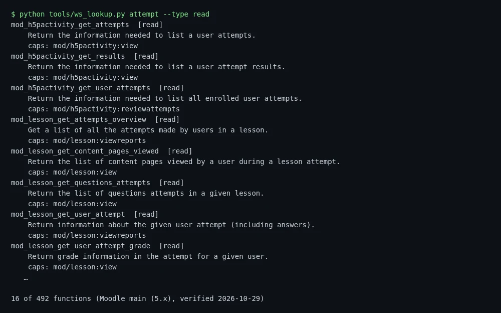
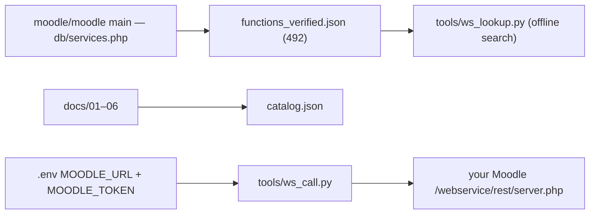
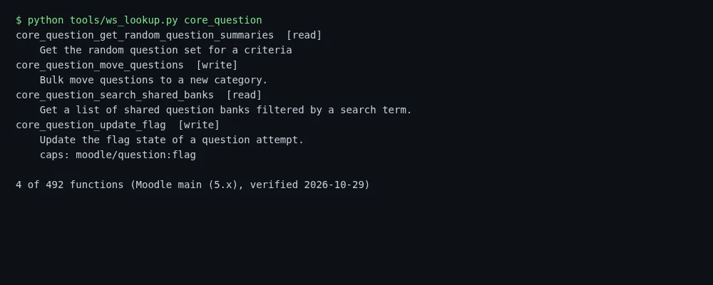

<div align="center">

<div style="font-size:64px">📚</div>

# moodle-kb

**What Moodle 4.x/5.x can and cannot do through its API — researched, verified, searchable.**

  <a href="https://github.com/LucianCeusanRo/moodle-kb/actions/workflows/ci.yml"></a>
  <a href="LICENSE"></a>
  
  <a href="https://github.com/LucianCeusanRo/moodle-kb/stargazers"></a>
  <a href="https://github.com/LucianCeusanRo/moodle-kb/commits/main"></a>

[English](#-about) · [Română](#-română)

</div>

<p align="center"></p>

## 📑 Table of contents

- [📖 About](#-about)
- [✨ Features](#-features)
- [🔑 Key findings](#-key-findings)
- [📂 Contents](#-contents)
- [🧠 How it works](#-how-it-works)
- [⚡ Quick start](#-quick-start)
- [📚 Step-by-step tutorial](#-step-by-step-tutorial)
- [🔧 Configuration](#-configuration)
- [🗂️ Project structure](#-project-structure)
- [⚠️ Limitations](#-limitations)
- [❓ FAQ](#-faq)
- [🗺️ Roadmap](#-roadmap)
- [🤝 Contributing](#-contributing)
- [📄 License](#-license)
- [🇷🇴 Română](#-română)
- [👤 Author](#-author)

## 📖 About

A research notebook I wrote while building [LSPilot](https://github.com/LucianCeusanRo/lspilot): how Moodle is organised, what its REST web services can and **cannot** do, how quizzes and question formats work, how to detect exam mode reliably, and which integration route (web-service token, local plugin, LTI 1.3) fits which use case. It comes with a machine-readable map of **492 web-service functions** verified against `moodle/moodle` branch `main` (`db/services.php`, 2026-10-29) and two small Python helpers.

- **What:** Markdown docs + JSON data + 2 dependency-free Python scripts.
- **What it is used for:** answering quickly "is there a stock API for X?", "which capability does this need?", "can I create a quiz through REST?" (short answer: not with question content — see `docs/02-webservice.md`), and planning a Moodle integration without reading the whole Moodle source.
- **Who it helps:** developers of Moodle plugins, browser extensions or school tools; Moodle admins deciding what to enable; teachers who want to import AI-drafted questions with GIFT / Moodle XML.

## ✨ Features

- 📚 **Six chapters** on Moodle architecture, web services, quizzes, student-side data, integrations (LTI 1.3, plugins, GDPR) and a gap backlog.
- ✅ **492 web-service functions** verified against `moodle/moodle` `main` — with read/write type, required capabilities and source link.
- 🔎 **Offline search** by text, type or capability with `tools/ws_lookup.py`.
- 🔌 **One-command API test** on your own Moodle with `tools/ws_call.py` and a token in `.env`.
- 📝 **GIFT and Moodle XML examples** for importing reviewed questions.
- 🛡️ **Exam-mode rules** (URL, DOM and Safe Exam Browser markers) for tools that must stay off during graded attempts.

## 🔑 Key findings

1. Stock Moodle REST **cannot create questions** or fully build a quiz with its content. Practical path: AI draft → human review → **GIFT / Moodle XML** import; automatic publishing needs a local plugin (e.g. `local_lspilot`) and/or LTI Deep Linking.
2. Read APIs for quizzes, attempts, reviews, grades, calendar and completion are rich — enough for a legitimate student companion, provided exam mode fails closed on `attempt.php`, Safe Exam Browser, passwords and timers.
3. Recommended architecture: cloud service + optional school plugin + later LTI; never scrape passwords; keep tokens server-side.

## 📂 Contents

| File | What you find there |
|---|---|
| [docs/01-architecture.md](docs/01-architecture.md) | Courses, sections, modules, question bank, roles & capabilities, enrolments, gradebook, completion, SEB |
| [docs/02-webservice.md](docs/02-webservice.md) | Enabling web services (admin checklist), token model, function catalog, what is NOT possible, `local_lspilot` design |
| [docs/03-quiz.md](docs/03-quiz.md) | Quiz settings, question types, GIFT and Moodle XML examples, exam-mode URL/DOM heuristics |
| [docs/04-student.md](docs/04-student.md) | Grades, attempt review, calendar, completion, Moodle App / mobile API |
| [docs/05-integration.md](docs/05-integration.md) | LTI 1.3, plugin directory requirements, Privacy API / GDPR, auth comparison |
| [docs/06-gaps.md](docs/06-gaps.md) | Build backlog P0–P3 with effort sizes and explicit non-goals |
| [functions_verified.json](functions_verified.json) | 492 functions: description, read/write type, capabilities, source link |
| [catalog.json](catalog.json) | Machine-readable summary (exam-mode URLs, relevant functions, sources) |
| `tools/ws_lookup.py` | Search the function map by text, type or capability |
| `tools/ws_call.py` | Call one REST function on your own Moodle with a token from `.env` |

## 🧠 How it works



The docs explain the concepts; `functions_verified.json` lists every web-service function with read/write type, capabilities and source link; the two scripts search it offline or call one function on your own Moodle.

**Tech stack:** Markdown, JSON, Python 3.8+ (standard library only).

## ⚡ Quick start

```bash
git clone https://github.com/LucianCeusanRo/moodle-kb.git && cd moodle-kb
python tools/ws_lookup.py quiz --type read
```

## 📚 Step-by-step tutorial

### 1. Get it
```bash
git clone https://github.com/LucianCeusanRo/moodle-kb.git && cd moodle-kb
```
Python 3.8+ only, no packages to install.

### 2. Search the function map offline
```bash
python tools/ws_lookup.py quiz                  # name or description contains "quiz"
python tools/ws_lookup.py attempt --type read   # only read functions
python tools/ws_lookup.py --cap mod/quiz:view   # by required capability
```


### 3. (Optional) call your own Moodle
1. In Moodle, follow the admin checklist in `docs/02-webservice.md`: enable web services → enable REST → create an external service with only the functions you need → create a token for a test user.
2. Configure:
   ```bash
   cp .env.example .env     # set MOODLE_URL and MOODLE_TOKEN (never commit .env)
   ```
3. Try it:
   ```bash
   python tools/ws_call.py core_webservice_get_site_info
   python tools/ws_call.py mod_quiz_get_quizzes_by_courses courseids[0]=2
   ```

### 4. Typical use
Planning a feature, e.g. "show a student their wrong answers after a quiz": read `docs/04-student.md` → find `mod_quiz_get_user_attempts` and `mod_quiz_get_attempt_review` with `ws_lookup.py` → check the exam-mode rules in `docs/03-quiz.md` so nothing runs during a graded attempt.

## 🔧 Configuration

Only `tools/ws_call.py` needs configuration: copy `.env.example` to `.env`.

| Variable | Required | What it does |
|---|---|---|
| `MOODLE_URL` | for ws_call | base URL of your Moodle site |
| `MOODLE_TOKEN` | for ws_call | web-service token of a test user |

## 🗂️ Project structure

```
docs/01-architecture.md … 06-gaps.md   six chapters
functions_verified.json                 492 verified functions
catalog.json                            machine-readable summary
tools/ws_lookup.py, tools/ws_call.py    helpers
docs/screenshots/                       images
```

## ⚠️ Limitations

- Snapshot of Moodle `main` on 2026-10-29; function lists change between versions (Moodle 5.1+ may move code under `public/`). Re-check against your site's *Web service API functions* page.
- Capabilities are copied from `services.php` and may not list every check done inside a function.
- Exam-mode detection rules are heuristics, not a security boundary.
- Written for LSPilot's needs, so coverage focuses on quizzes, questions and student-side reading; other areas (forums, workshops, badges…) are only touched briefly.

---

## ❓ FAQ

<details><summary><b>Can I create a quiz with questions through the stock REST API?</b></summary>

No — see `docs/02-webservice.md`. Use GIFT / Moodle XML import or a local plugin.

</details>

<details><summary><b>Is the function list up to date?</b></summary>

It is a snapshot of `main` from 2026-10-29; check your own site's *Web service API functions* page.

</details>

## 🗺️ Roadmap

- [ ] Diff tool between two Moodle versions
- [ ] Examples for LTI 1.3 Deep Linking
- [ ] Coverage of forum and assignment APIs

## 🤝 Contributing

Issues and pull requests are welcome. Please keep changes small, describe how you tested them, and never commit real credentials — use `.env` (git-ignored) and update `.env.example` with placeholders only.

## 📄 License

Documentation and scripts: MIT — see [LICENSE](LICENSE). Function names/descriptions come from Moodle (GPL v3) `db/services.php` files and are referenced for interoperability.

## 🇷🇴 Română

<details>
<summary><b>Click pentru versiunea în limba română</b></summary>

Un caiet de documentare scris când am construit [LSPilot](https://github.com/LucianCeusanRo/lspilot): cum e organizat Moodle, ce pot și ce **nu** pot face serviciile web REST, cum funcționează testele și formatele de întrebări, cum detectezi corect modul examen și ce variantă de integrare (token, plugin local, LTI 1.3) se potrivește. Include o hartă JSON cu **492 de funcții** verificate pe `moodle/moodle` ramura `main` (29.10.2026) și două scripturi Python mici.

#### Ce este și la ce folosește
- **Ce:** documente Markdown + date JSON + 2 scripturi Python fără dependențe.
- **La ce folosește:** să afli repede „există API pentru X?”, „ce permisiune trebuie?”, „pot crea un test prin REST?” (pe scurt: nu cu întrebări cu tot — vezi `docs/02-webservice.md`) și să planifici o integrare fără să citești tot codul Moodle.
- **Pe cine ajută:** dezvoltatori de pluginuri, extensii sau unelte pentru școli; administratori Moodle; profesori care vor să importe întrebări prin GIFT / Moodle XML.

#### Concluzii principale
1. REST-ul standard **nu poate crea întrebări** și nici un test complet; soluția practică e ciornă AI → verificare umană → import **GIFT / Moodle XML**; publicarea automată cere plugin local și/sau LTI.
2. API-urile de citire (teste, încercări, revizuiri, note, calendar, finalizare) sunt suficiente pentru un asistent legitim pentru elevi, cu mod examen care blochează pe `attempt.php`, SEB, parolă și cronometru.
3. Arhitectură recomandată: serviciu cloud + plugin opțional + LTI mai târziu; fără parole colectate, token-uri doar pe server.

#### Tutorial
1. `git clone …` (doar Python 3.8+).
2. Căutare offline: `python tools/ws_lookup.py quiz`, `--type read`, `--cap mod/quiz:view`.
3. Opțional, pe Moodle-ul tău: urmează lista de pași din `docs/02-webservice.md`, apoi `cp .env.example .env` (MOODLE_URL, MOODLE_TOKEN) și `python tools/ws_call.py core_webservice_get_site_info`.
4. Exemplu: pentru „arată elevului greșelile după test” citești `docs/04-student.md`, cauți `mod_quiz_get_attempt_review` și verifici regulile de mod examen din `docs/03-quiz.md`.

#### Structura proiectului
`docs/` (6 capitole), `functions_verified.json`, `catalog.json`, `tools/`, `docs/screenshots/`.

#### Limitări
- Instantaneu al Moodle `main` din 29.10.2026; lista de funcții se schimbă între versiuni.
- Permisiunile sunt cele din `services.php`; pot exista verificări suplimentare în cod.
- Regulile de detecție a examenului sunt euristici, nu o barieră de securitate.
- Accent pe teste, întrebări și citire pentru elevi; alte module sunt tratate pe scurt.

</details>

## 👤 Author

**Lucian-Ciprian Ceușan** — telecom & network technician, Bucharest, Romania

[](https://lucian-ceusan.vercel.app) [](https://www.linkedin.com/in/lucian-ceusan-7a9179210) [](https://github.com/LucianCeusanRo)
